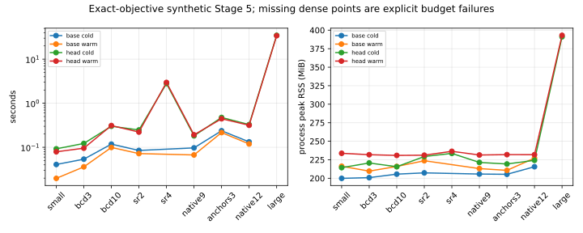

# Stage 5: exact finite-grid positive GP inference

This is an opt-in experimental implementation of the accepted Stage 4 posterior.
It does not change production defaults or confer scientific promotion. The dense
implementation in `src/gp_identifiability.py` is unchanged and remains an
independent numerical oracle. Agreement with that reference does not establish
that its physical model is adequate for real BCDs.

## Dependency, ownership and isolation

Accepted Stage 4 reference: `321c8541fc1abec7618bb474c66613d8d487a593`, after
independent re-review resolved RV26-01. PR #26 merged as
`05d6a77931c06851f4cc1e04cca255e7e75f764a`; the two trees are identical. The requested
stack base `codex/04-gp-identifiability-20261125-03` was deleted on the remote after
merge. Following the launch's post-integration instruction, this author branch was
created at the accepted SHA and reconciled onto the actual merge commit before
implementation; the PR targets `main`.

Run `20261126-05` owns branch `codex/05-scalable-solver-20261126-05` and worktree
`.worktrees/author-05-scalable-solver-20261126-05`. The independent paired base is
`.worktrees/base-05-scalable-solver-20261126-05`, detached at the merge commit.
Original and other author/reviewer checkouts are not modified. The Stage 4 re-review
Python 3.11.15 environment is read-only; `uv pip check` verifies all 45 installed
packages. Caches, plots, draws and run outputs are author-local. No dependencies
were added. No private FITS data is published.

## Objective and exactness

For physical host and source coefficients theta, retain the Gaussian model

    theta ~ N(m, K),  y | theta ~ N(A theta, N),  theta >= 0.

Host covariance is precisely the Stage 4 Matérn 3/2 kernel on the supplied angular
grid. Amplitude is SD in Jy/native pixel; scale is in arcseconds. Source priors
have the declared zero-mean Gaussian SD before positive truncation. No host/source
orthogonalization, diagonal GP substitute, covariance taper, low-rank GP, jitter,
error inflation, cropped-point-response renormalization or changed likelihood
cross term is introduced.

The finite host grid is embedded in a larger circulant covariance. Its FFT spectrum
must be strictly positive; otherwise the embedding grows within a declared memory
budget or fails. Restricting this auxiliary Gaussian field to the original grid
recovers the exact finite Matérn covariance. The finite covariance action zero-pads
the input into that embedding and restricts the result. Neither operation adds
periodic coupling to the requested host covariance. Eigenvalues are never clipped.

Condition in observation space:

    B = K A.T,  S = N + A B
    posterior mean = m + B S^-1 (y - A m)
    posterior covariance action(v) = K v - B S^-1 B.T v.

The Schur factorization uses diagonal scaling for numerical conditioning and checks
the original operator residual, with three residual checks and refinement. Failure
above the declared relative tolerance (default `1e-10`) raises. Selected covariance
exports use the Joseph quadratic form, with selected unit columns E:

    V = S^-1 B.T E,  R = E - A.T V
    selected covariance = R.T K R + V.T N V.

This avoids subtracting almost equal covariances at high information. The residual
formation roundoff bound must resolve variance to `1e-8` relative precision or the
export raises; there is no variance floor or extra noise. This is a partial
roundoff check, not a bound on total covariance error: gain-solve and kernel/FFT
errors can exceed it in extreme near-null cases (deferred P3 RV27-02 below).
The general subtractive covariance-action interface also refuses unresolved
cancellation. Selected export
storage is O(p*k+n*k+k**2); no full large host inverse/covariance is constructed.

An independent prior draw z and measurement-noise draw epsilon give an IID
posterior Gaussian draw

    posterior_mean + z - B S^-1 (A z + epsilon).

Jointly reject negative physical coefficients. Independently estimate the prior
host orthant mass; the source contribution is analytic, `2**(-number_of_sources)`.
Positive evidence is Gaussian evidence times posterior/prior orthant mass. These
are the Stage 4 normalization factors, not a MAP or boundary-Laplace surrogate.
Two 97.5% Wilson mass bounds retain the Stage 4 approximate Bonferroni 95% evidence
interval. Evidence/moments have Monte Carlo error, rather than exact integration.
The ordinary accepted-count gate remains 512. Rare orthants explicitly fail.

Accepted draws are saved in bounded independent NPY batches. Selected positive
moments, model mixtures and predictive covariance retain host/source correlation,
active-bound effects, and between-model variance. Conditional likelihood integrates
over the positive template posterior; template IDs cannot be reused. Held-out
template evidence uses a joint/old Gaussian and positive-mass ratio, counting each
exposure once. Low importance ESS remains an explicit failed diagnostic.

## Instrument, nuisance and optimization contracts

`scalable_operators.frozen_host_operator` snapshots the established sparse WCS
projection and anchor kernels for either existing operator order. Later global
configuration or WCS changes do not change the snapshot. Native point and nuclear
responses use the unchanged Stage 2/3 calibrated renderers. Adjoint checks run
before conditioning. Invalid pixels are excluded before arithmetic.

Measured repeated native FFT calls motivated a bounded exact sparse row cache
built during adjoint assembly. Every nonzero coefficient, including numerical
roundoff, is retained. If the cache's peak would exceed the cap it is omitted;
the original exact operator remains in use. This is an acceleration policy, not a
different scientific model.

Independent background calibration is subtracted once and marginalized with
`N_i = diag(sigma_i**2) + tau_i**2 11.T`. Weighted common/differential-mode separation
retains the full rank-one covariance and its determinant without subtracting two
large precision-weighted vectors. Every noise solve checks the original equations
for each RHS at `1e-10`; unrepresentable multi-pixel limits raise with residuals.
The scalar remains supported even when background variance dominates by `1e20`.
`nuisance_moments` exports joint selected
physical/background covariance, including expected conditional background variance
and covariance of conditional means. Background offsets remain signed.

`GaussianPosterior.bounded_mode` is an optional diagnostic of the constrained
objective, separate from posterior integration. Full GP precision actions use
residual-checked PCG; the restricted circulant inverse is only a preconditioner.
L-BFGS-B uses physical nonnegative bounds and variable scaling. A scaled projected
gradient above the declared KKT tolerance raises, irrespective of optimizer status.
Clipping the unconstrained solution is never returned as a constrained fit.

Geometry remains conditional, exactly as in the accepted Stage 4 reference.
Nonzero registration covariance is rejected; uncertain positions require separately
declared geometry alternatives. Source derivative identity is tested, but this
path does not implement floated-position iterations or marginalize continuous
geometry. It does not introduce transient estimation or epoch grouping. Existing
production nonnegativity, <=1-day sharing and exact template-zero contracts remain
unchanged; Stage 6 owns transient boundary/coverage inference.

## Memory model and unsupported regimes

Host scaling is O(p n + n**2 + batch * embedding_pixels) in memory, where p is
host/source parameters and n is valid native pixels. GP actions/sampling use FFTs;
observation factorization remains dense O(n**3). This is deliberately a scalable
host implementation, not a claim of unbounded BCD-count scaling.

The default numerical-array cap is 512 MiB and draw-payload disk cap is 2 GiB.
The paired scaling demonstration additionally declares a 1 GiB process RSS cap,
including Python/imports. Estimates include retained operators, cross covariance,
factorization workspaces, FFTs, selected solves and sparse-cache construction.
Memory/disk failures are explicit and never change prior, data, masks or tolerance.

FFT workspace has a separate 8 MiB target. Columns are chunked internally, with
at least one field required to fit the overall memory cap. The posterior proposal
batch and total draw count stay fixed; host white-noise ordering and the subsequent
source draws are unchanged. Diagnostics record the actual FFT chunk shape. This
policy addresses measured SR=2 workspace growth and an SR=4 allocation refusal,
without changing the finite covariance or accepted-count gate. The original failed
sweep remains in the artifact bundle.

Unsupported: irregular/nonorthogonal host grids; multiple GP components; exact
scene-PRF mode (it is rejected, never silently changed to anchors); a large
observation covariance exceeding the cap; embeddings whose positive spectrum
cannot be established within budget; rare orthants unresolved at the declared
proposal count; arbitrary large full predictive covariance; continuous geometry
uncertainty; real-BCD scientific acceptance; production full-campaign integration.
Proper priors can regularize a likelihood-null direction without making it
data-identifiable. Large fits report the likelihood rank upper bound explicitly;
they do not claim a complete large null-space diagnosis. Coincident-component
tests require broad anticorrelated positive uncertainty.

## Validation and performance protocol

Required numerical tests cover finite-kernel FFT identity, Gaussian draws, full
noise, Gaussian evidence/means/predictions/derivatives, selected covariance,
positive truncated-normal moments/evidence, conditional likelihood, evidence
mixtures, nuisance elimination, active-bound KKT, explicit failures, calibration
gauge, invalid pixels, frozen configuration, SR=1/2/4, both operator orders and
multiple anchors. Real-table tests are separately labeled and never stand in for
absolute calibration or held-out real BCDs.

`scripts/validate_stage5.py` consumes the Stage 1 artifact writer and the corrected
Stage 4 independent optical sky. Positive/zero source fluxes, source/nucleus
separation, masks, one/three templates and three development noise seeds are kept
at their original physical/noise difficulty. The reserved acceptance set is not
touched. Gaussian arrays use Stage 1 identity gates; covariance additionally must
agree to `1e-8` in marginal-SD product units so small Jy-squared values cannot pass
only because of an absolute tolerance. Positive means/covariances compare within
six combined Monte Carlo SE; evidence intervals must overlap. These are numerical
identity criteria, not post-hoc scientific-bias thresholds.

`scripts/run_stage5_benchmarks.py` uses Stage 1's existing alternating isolated
worker runner, numerical comparisons and engineering-budget implementation. The
original Stage 1 benchmark remains required and unchanged. Cold and warm cases
use identical pixels, seeds, priors, calibration, thread count and proposal budgets
on base/head. Suspected regressions get a confirming paired run. >10% relative
MAD is inconclusive; the 25% plus 0.25 s time and 20% plus 20 MiB memory gates are
unchanged. No speed ratio is computed when the dense reference rejects a case.
All initial and confirmation records must complete and meet the hard 1 GiB RSS
cap (the declared dense-base memory refusal is allowed only in initial records).
Missing records, stale success flags and incomplete confirmations fail the CLI.
Here **warm means a same-process rerun**, after a discarded run. Each run rebuilds
instrument operators, the prior and fit, and clears/restores instrument caches;
this does not measure retained operator or fitted-state caches. Earlier raw warm
records have the same protocol and remain unchanged.

The sweep varies native size, actual scene SR, BCD count, anchor count and host
footprint. The large case retains 10 BCDs, 800 valid native pixels, a 128x128 host
grid and two sources. Its 8,192-proposal budget retains the 512-accepted gate;
the earlier 1,024-proposal/74-accepted pilot is insufficient under that gate and
is retained as exploratory evidence. No physical difficulty was reduced.

The existing required Python 3.11/3.12 jobs discover all numerical tests and run
the small science comparison consumer. The existing performance job additionally
runs paired small/native9 posterior cases using the same Stage 1 machinery. Full
scaling and larger development experiments are local/manual evidence.

## Re-review disposition and bounded acceptance follow-up

Independent re-review of `853ea296f3660eeeded8ece9ef6585157873e73c` resolves
RV27-01 and RV27-03 through RV27-06. RV27-02's original zero-variance blocker is
resolved. Its remaining precision-bound limitation is an explicitly deferred,
nonblocking **P3**; another broad correction cycle is not requested.

The saved 90-digit Decimal probes return marginal-SD-product-scaled covariance
errors of `1.2214031646228625e-7` for near-collinear observation columns and
`9.52867542459389e-7` for a very broad kernel. Positive, nonzero variance is
preserved, but the current guard does not fully propagate gain-solve or kernel/FFT
error. The earlier scalar/correlated tests and the new probes examine different
conditioning regimes, so their results do not disagree. The earlier tests do not
establish the stronger accuracy bound. The [saved probe results and source hashes](stage5_evidence/rv27-p3-deferred.json)
retain this evidence without changing the numerical implementation.

The P3 follow-up must incorporate both saved behavioral probes, retain their
physical difficulty, and require covariance error <=`1e-8` against an independent
high-precision oracle or explicit `NumericalFailure`. It must rerun affected science
tests and paired benchmarks. No jitter, variance/noise floor, or threshold relaxation
is authorized. This documentation does not claim that follow-up is implemented.

Required performance acceptance remains open. The [predeclared acceptance run](STAGE5_ACCEPTANCE_20261127.md)
specifies one execution of the existing required CI benchmark job, preserving all
earlier failed/inconclusive results and gates. Local preflight found substantial
unrelated workstation load; no local acceptance measurements were started.
The PR body and the run's immutable artifacts record the result after execution.
Persistent dispersion is unresolved and will not trigger reruns until green.

Stage 6 implementation requires accepted, reviewed Stage 5 integration. At this
handoff PR #27 is open against `main` at
`05d6a77931c06851f4cc1e04cca255e7e75f764a`; that SHA contains Stage 4, not Stage 5.
It is not a valid Stage 6 dependency. Stage 6 remains read-only preparation until
the approved integrated `BASE_REF` and `PR_BASE` are verified. Bias/coverage
tolerances, held-out real BCDs and absolute calibration also remain unapproved.

## Independent-review corrections RV27 (historical author report)

The bounded correction starts from reviewed head
`0aec6a1506d55e64aee85132c94d8b530ede0b5d`, still against integrated base
`05d6a77931c06851f4cc1e04cca255e7e75f764a`. Numerical correction commit:
`bd81559148112a460a7bdbc2bc22b5266521c351`. The independent review record and probes
are read-only inputs; new outputs live in `.test-artifacts/stage5-rv27/` in the
author worktree. The dense reference, physics, priors, proposal/acceptance counts,
CI workflow and Stage 1 benchmark implementation are unchanged.

- **RV27-01:** background solves separate weighted common/differential modes,
  including the zero-background diagonal limit. Per-exposure, per-RHS residuals
  enforce the original `1e-10` solve precision. The review scalar returns mode
  1.5 and predictive scores -1.1810780822461169 and -136.1577621784771, agreeing
  with independent same-draw references within `3e-14`. Scalar and unequal-variance
  common-mode solves remain accurate through a `1e20` background/native variance
  ratio. Unresolved differential modes raise with diagnostics. Behavioral tests
  cover 80-digit arithmetic, objective gradients, bounded mode, likelihood, ESS,
  mismatch diagnostics and masking of small failures by bright exposures/RHS.
- **RV27-02:** selected covariance uses the Joseph form above. Independent
  information-form tests retain scalar variances through `1e-20` and correlated
  variances through `1e-16`, with maximum scaled error below `1e-15` in the recorded
  sweep. More extreme requests explicitly fail the roundoff test. The scalar
  `1e-16` result is `1e-16`, not zero; no variance/noise floor is applied.
- **RV27-03:** every initial and confirmation record is checked for completion,
  paired repeat counts and the hard RSS cap before numerical comparisons. Both
  sides are checked. Confirmation-only failure/missing-record/over-cap controls
  fail, including an inflated cap or stale success flag. A subprocess regression
  verifies CLI exit 1; valid and noisy confirmations retain their existing gates.
- **RV27-04:** direct prior sampling guards retained output plus live FFT/source
  workspaces before allocating or advancing the RNG. The 128 MiB output requested
  under a 64 MiB cap is refused; allowed draws and FFT-chunk RNG identity pass.
- **RV27-05:** Python and NumPy integral host indices preserve all mixture means
  and within/between-model covariance terms. Invalid component types raise;
  named sources absent from a model retain their intended zero contribution.
- **RV27-06:** warm is explicitly labeled as a same-process rebuild, including
  its cleared/restored instrument-cache state. Existing raw labels/data are kept.

All six findings are addressed for independent re-review, with no disagreement or
scientific-promotion claim. The correction's required CI tests include 37 additional
behavioral cases. Local final validation passes 526 non-slow tests (five skips),
six integration tests, six real-PRF algebra tests (one unavailable-input skip) and
all 18 synthetic science comparisons. The latter's maximum selected-covariance
error is `5.93e-14` in marginal-SD units. Development bias, mismatch and limited
coverage conclusions remain unchanged.

The numerical correction's first CI run passed Python 3.11/3.12, but the unchanged
Stage 1 cold benchmark was inconclusive: base/head relative timing MAD 51.4%/37.5%
against 10%. Numerical differences were zero and allocation gates passed. That
job exited 4 and skipped the Stage 5 step; this is retained, not reported as a pass.
See [the recorded CI failure](https://github.com/UCSC-Transients/spitzer_photometry/actions/runs/45755742007/job/139693813529)
and the exact final-head checks on the PR.

The correction reruns all nine scaling fixtures with five cold and warm pairs,
one thread and identical base/head input hashes. BCD3, BCD10, SR2, native9,
anchors3 and native12 pass both modes; anchors3's initial timing crossing did not
repeat in confirmation, whose completion and hard-RSS checks also pass. Small
cold/warm remain inconclusive under the unchanged dispersion gate, so the overall
local command exits 1. SR4 and large complete on the head with the expected dense
base refusal. All comparable numerical, positive-moment and evidence gates pass.

The large corrected case's cold/warm medians are **33.960/33.312 s**, with maximum
RSS **416.6 MiB** under 1 GiB. All ten head runs accept 624 posterior and 786 prior
draws. There is no large dense-run speedup ratio. Relative to the previous Stage 5
synthetic record, Gaussian mean, evidence and native prediction are unchanged;
selected covariance changes by at most `8.20e-12` in marginal-SD units. This last
comparison is explicitly to the previous scalable record, not an independent
large dense oracle. No earlier failure or inconclusive measurement is removed.

Correction evidence: [metrics, source hashes and all paired records](stage5_evidence/rv27-corrections.json),
[high-dynamic-range arrays](stage5_evidence/rv27-dynamic-range.npz),
[large-case arrays](stage5_evidence/rv27-large-synthetic-arrays.npz) and
[scaling plot](stage5_evidence/rv27-scaling.svg). Full configurations, seeds, raw
draws, logs, failures and manifests remain in `.test-artifacts/stage5-rv27/`.
The original evidence below is retained as history rather than overwritten.

## Initial reviewed run 20261126-05

The numerical implementation and scaling worker were fixed at
`9a3645acaad80e367f654a977d1224f085164673` for the final five-pair sweep against
`05d6a77931c06851f4cc1e04cca255e7e75f764a`. Commits through reviewed head `0aec6a1`
add the distinct-model mixture regression and this evidence; original numerical-source checksums are in
[metrics.json](stage5_evidence/metrics.json). Required Python 3.11, Python 3.12 and
paired performance CI passed on the numerical commit. Review the PR checks for
the exact final head.

The large case has 16,386 parameters and 800 valid native pixels. Cold/warm median
runtimes are 34.750/34.118 seconds, median RSS 391.0/393.0 MiB, maximum RSS 413.5 MiB,
and estimated live numerical storage 277.2 MiB. All ten runs accept 624 posterior
and 786 prior-host draws from 8,192 proposals, above the unchanged 512 gate. The
largest retained matrix is 16,386 by 800; the observation factor is 800 by 800 and
FFT workspace is two 256 by 256 fields. Adjoint error is `8.65e-18`; maximum solve
residual is `6.19e-13`. The dense reference refuses before allocation; its legacy
dense estimate is 10.78 GB. This is a completed memory-guarded case, not a measured
speedup over a completed dense fit.

The final sweep has no confirmed time/RSS regressions. Small/warm, BCD10/warm and
native9/cold+warm remain **inconclusive** under the existing 10% relative-MAD gate;
the overall local benchmark command therefore exits 1. All comparable numerical,
positive-moment and evidence checks pass. SR=4 and the large case complete only on
the scalable side and carry explicit baseline-guard status. Small cases are
slower: native12 cold is 0.133 to 0.327 seconds and warm 0.119 to 0.316 seconds.
Passing an absolute engineering budget does not imply acceleration. The earlier
SR=2 memory regression, SR=4 embedding refusal and inconclusive measurements are
retained in the public metrics as well as the full local records.

Final fast regression: 489 passed, 5 skipped; separately selected real-calibration
checks: 6 passed, 1 skipped (unavailable real-data input). Targeted N=1/2/10 and
native-forward/solver integration: 6 passed. Those legacy integration cases emit
three warnings about the old smoothed diagonal prior; they are not evidence for
the new Matérn path. The final 18 synthetic science cases all pass equivalence:
maximum Gaussian mean difference `1.96e-15` Jy, covariance error `9.61e-12` in
marginal-SD product units, positive-mean discrepancy 2.98 combined Monte Carlo SE.
Bias ranges from -0.0535 to +0.3349 mJy, with 9/18 inherited model-mismatch flags.
All 12 positive-flux intervals include their truths, but these span only three
independent development noise seeds and do not establish acceptance coverage.
Zero-flux upper limits are recorded separately; inclusion is not detection coverage.

The optional bounded-mode profile converges in 16 iterations with projected
gradient `3.03e-8`; the one-iteration control fails explicitly. A standalone export
profile records GP precision (10 PCG iterations), selected Gaussian covariance,
positive prediction and joint nuisance covariance, including operation counts and
tracked allocations. These phase timings are diagnostics, not paired speed claims.
Fit diagnostics stop counting at completion of posterior sampling; export counts
are recorded separately. Position iterations remain unsupported conditional
geometry. The generic dense-noise adapter cannot export background nuisance
moments without an explicit decomposition; that guarded profiling failure is kept.

Public synthetic-only evidence includes [metrics](stage5_evidence/metrics.json),
[large-case numerical arrays](stage5_evidence/large-synthetic-arrays.npz),
[scaling plot](stage5_evidence/scaling.svg) and [checksums](stage5_evidence/checksums.json).
The NPZ contains Gaussian mean, native prediction, selected covariance and evidence;
it is not a real-data product. Reproduce the sweep with `scripts/run_stage5_benchmarks.py`
using separate base/head checkouts, five repeats, 1,024 ordinary proposals and the
declared 8,192 large-case proposals. Reproduce the science comparison with
`scripts/validate_stage5.py --draws 8192` and an unused output directory.

## Artifacts and promotion

The local run bundle is `.test-artifacts/stage5/` in the author worktree. It retains
launch/source-document hashes, environment freeze, initial failure JUnit, later
JUnit, source profiles, real-calibration identity, positive draw batches, JSON/NPZ
science arrays, convergence histories, paired raw records, checksums and scaling
plots. Benchmark failures are saved alongside completed samples. The PR supplies
measured results and exact tested refs. Numerical arrays support conclusions;
plot appearance is not a scientific acceptance criterion.

Scientific promotion stays unapproved: no absolute bias tolerance was supplied;
three development seeds cannot establish coverage; inherited footprint/model
mismatch remains; continuous geometry/hyperparameter uncertainty is conditional
or represented only by declared alternatives; absolute warm calibration and real
held-out BCD acceptance are unmet. The independent reviewer must inspect exact
posterior/evidence preservation, rare-mass failures, nuisance covariance, memory
accounting, numerical gates, and unsupported regimes in a fresh checkout.
